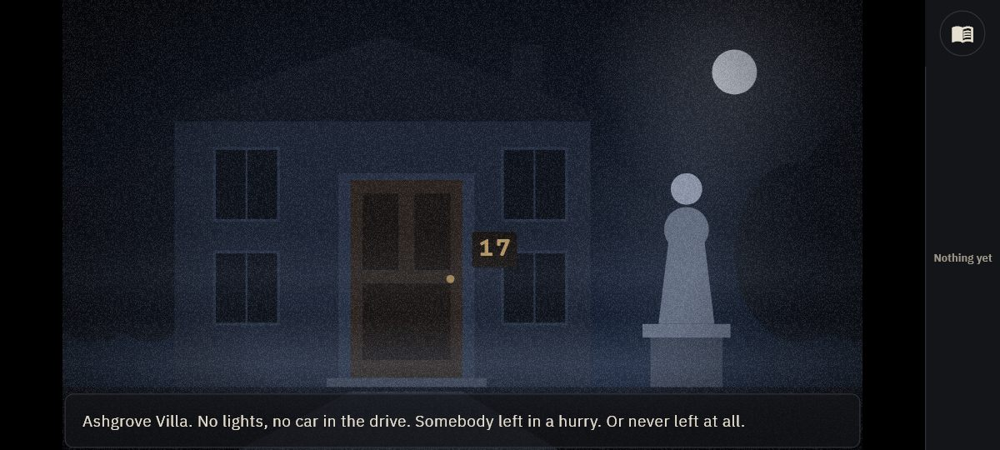
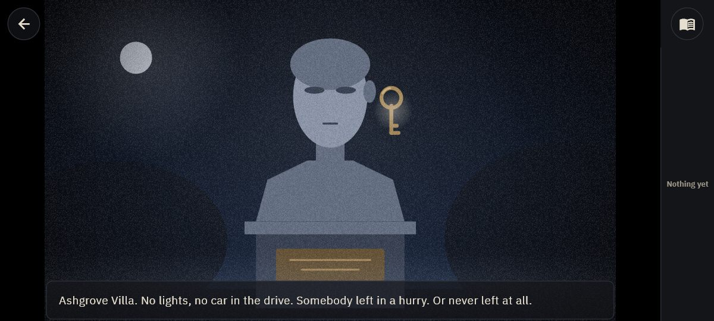
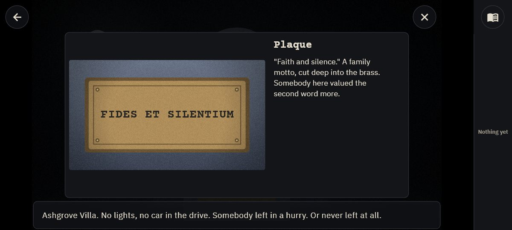
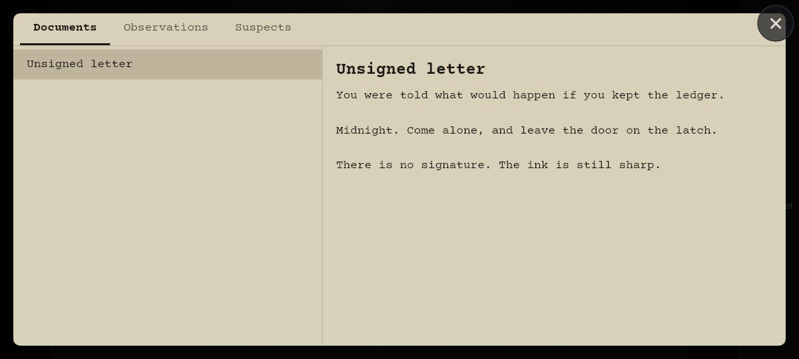
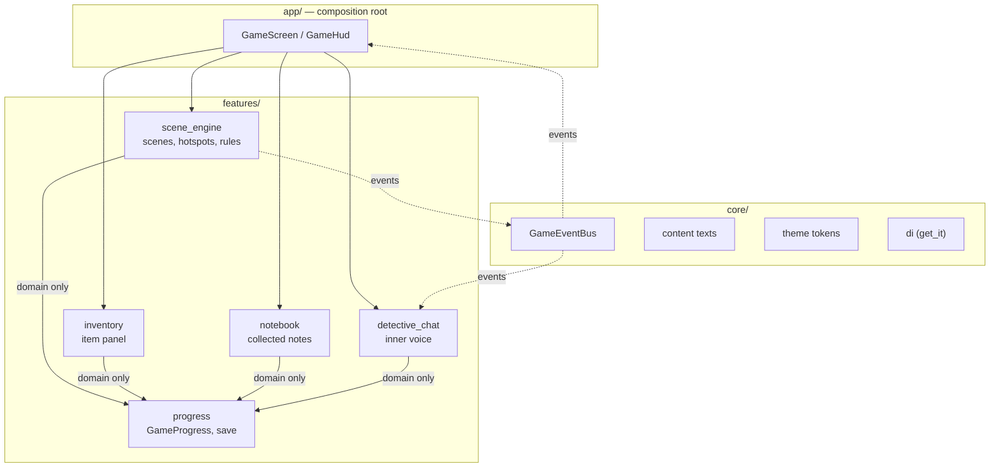
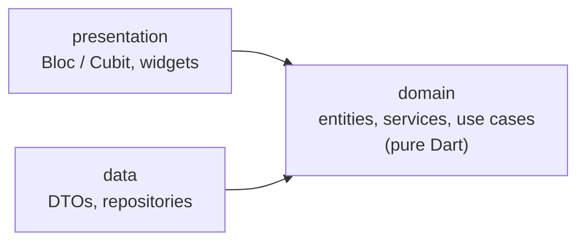
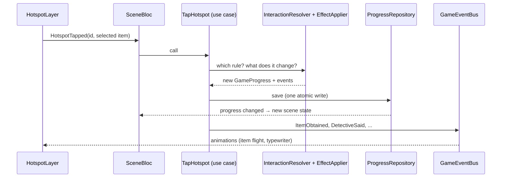

# DetectiveDark

[](https://github.com/asklife23/DetectiveDark/actions/workflows/ci.yml)

A noir, 2.5D point-and-click detective game for Android, iOS and Steam (Windows), built with Flutter.

Explore moody, hand-crafted scenes, tap on details others would miss, collect items and
documents, crack the puzzles and convince the police with the evidence you found.

> 🚧 Work in progress. Phase 1 (the game engine and a playable vertical slice) is done; the story, the real
> artwork and saving come next. See [`plan.md`](plan.md) for the roadmap.

| | |
|---|---|
|  |  |
|  |  |

_Screenshots of the vertical slice. The pictures are placeholder drawings made in code (`CustomPainter`);
the real artwork arrives in Phase 7._

## Features

What the vertical slice already does:

- **Scenes and close-ups.** Locations form a parent → child tree. Tapping a door or a statue fades to its
  close-up; Back (button, Android system back or `Esc`) returns to the parent. No zoom, a calm 150 ms fade.
- **Hotspots without types.** Every tappable area carries an ordered list of rules: a condition and the
  effects it triggers. The first rule whose condition holds runs. New puzzles are new JSON, not new code.
- **Items.** Pick things up (they fly into the panel on the right), select one, then tap where to use it.
  The wrong place only earns a dry remark; the right place consumes the item and changes the scene.
- **Object layer.** Things that can be taken are separate pictures on top of the background and vanish with
  their hotspot, so a scene needs one background instead of one per combination of collected objects.
- **Notebook.** Documents, observations and people, with an unread badge. In the finale the evidence will
  be picked from here.
- **Inspection panel.** A look-only detail (a plaque, later a clock or a photo) opens in a small window
  without leaving the scene.
- **The detective's inner voice.** A one-way message bar that types each line and then gets out of the way,
  with a history of everything said.
- **Text is never baked into pictures.** House numbers, inscriptions and later codes and clock times are
  drawn by the game on top of the image, so puzzle answers are always legible and translatable.
- **One noir look.** A shared grain, vignette and tint layer makes every picture look like the same film.
- **Touch and mouse.** The same interactions on a phone and in a desktop window; the scene keeps its 16:9
  shape on every screen and hotspots scale with it.
- **Content safety net.** A validation test loads all game content on every push and rejects broken
  references, missing texts, misspelled flags, unreachable scenes and hotspots hidden under the interface.

## Tech stack

| Area | Choice |
|---|---|
| Framework | Flutter (Dart 3) |
| Platforms | Android, iOS, Windows (Steam) |
| Architecture | Feature-first Clean Architecture |
| State management | `flutter_bloc` + `equatable` |
| Dependency injection | `get_it` |
| Routing | `go_router` (app screens), scene navigation stack (in-game) |
| Localization | `gen-l10n` (ARB); English at launch, new languages by adding files |
| Fonts | Courier Prime + IBM Plex Sans (bundled, OFL, Latin Extended) |
| Local storage | Drift (SQLite) — planned (Phase 2) |
| Backend | Supabase (Auth, Postgres + RLS, Edge Functions) — planned (Phase 3) |
| CI | GitHub Actions (format, analyze, test, Windows build, Android build) |

## Architecture

Feature-first Clean Architecture. Each feature is split into `domain` (pure Dart: entities, rules, use
cases), `data` (JSON parsing, storage) and `presentation` (blocs, widgets). Dependencies point inwards only,
and a feature may import nothing but the `domain` of another feature. The `app/` layer is the single place
that puts several features on one screen.



Inside a feature:



The progress (`GameProgress`) is the single source of truth: the scene, the item panel, the notebook and
the message bar all read from `ProgressRepository`, and one tap is saved as one atomic change. The rules
are enforced by a test that reads the import lines of every file
(`test/architecture/dependency_rules_test.dart`). Decisions are recorded in [`docs/adr/`](docs/adr/).

### The interaction system

Hotspots have no type. A hotspot is a rectangle (normalized 0–1, relative to the scene image) with an
ordered list of rules; a rule is an optional condition (`when`) and a list of effects (`do`). This is the
lock of the front door, straight from the game content:

```json
{
  "id": "lock",
  "rect": {"x": 0.585, "y": 0.44, "width": 0.11, "height": 0.20},
  "labelKey": "hotspot_lock",
  "visibleWhen": {"notFlag": "front_door_open"},
  "interactions": [
    {
      "when": {"usingItem": "brass_key"},
      "do": [
        {"setFlag": "front_door_open"},
        {"consumeItem": "brass_key"},
        {"say": "say_door_unlocked"}
      ]
    },
    {"do": [{"say": "say_door_locked"}]}
  ]
}
```

Tapped with the brass key selected, the first rule runs: the door opens, the key is used up and the
detective comments. Tapped with nothing, the second rule answers "Locked." Tapped with any other item, only
a generic remark is given, so a wrong item can never trigger the normal interaction.

| Conditions | Effects |
|---|---|
| `flag`, `notFlag`, `hasItem`, `usingItem`, `hasNote`, `all`, `any` | `goToScene`, `giveItem`, `consumeItem`, `addNote`, `setFlag`, `hideHotspot`, `say`, `inspect` |

What happens on a tap:



`InteractionResolver` and `EffectApplier` are pure Dart with no side effects, which is why the whole
puzzle logic is covered by plain unit tests.

### Game content

Everything the player sees and solves lives in `assets/content/` as JSON: scenes, hotspots, items, notes,
inspections and texts. No scene text, coordinate or puzzle solution is written in code; a new scene is a new
JSON entry plus a picture.

```
assets/content/
  common/text_en.json              # shared texts
  cases/case01/
    case.json                      # chapters and their entry scenes
    chapters/ch01/
      scenes.json  items.json  notes.json  inspections.json
      text_en.json                 # a new language = a new text_xx.json
```

## Getting started

### Requirements

- Flutter 3.44 (stable) / Dart 3.12
- Android SDK (Android Studio)
- Visual Studio with "Desktop development with C++" (for the Windows build)

### Run

The app has three flavors, each with its own entry point and environment file:

| Flavor | Android app ID | Launcher name | Backend |
|---|---|---|---|
| `dev` | `io.github.asklife23.detectivedark.dev` | DD Dev | staging |
| `staging` | `io.github.asklife23.detectivedark.stg` | DD Staging | staging |
| `prod` | `io.github.asklife23.detectivedark` | DetectiveDark | production |

All three can be installed side by side on one device.

```bash
# 1. Create your local env files from the template (they are git-ignored).
cp env/example.json env/dev.json
cp env/example.json env/staging.json
cp env/example.json env/prod.json

# 2. Run a flavor.
flutter pub get
flutter run --flavor dev -t lib/main_dev.dart --dart-define-from-file=env/dev.json
```

The template sets `SHOW_DEBUG_OVERLAY` to `false`. To see the "DEV" badge, set it to `true` in
`env/dev.json` (or delete the key: without it the badge is on for `dev` only).

Android Studio picks up ready-made `dev`, `staging` and `prod` run configurations from `.run/`.

| Env key | Meaning |
|---|---|
| `SUPABASE_URL` | Supabase project URL (filled in Phase 3) |
| `SUPABASE_ANON_KEY` | Supabase anon / publishable key — never the service role key |
| `SHOW_DEBUG_OVERLAY` | Shows the flavor badge on screen. Optional; when the key is missing: on for `dev` only |

iOS flavors are set up in Phase 10.

### Windows (Steam build)

Windows has no native flavors; the entry point selects the build. Requires Visual Studio with the
"Desktop development with C++" workload.

```bash
cp env/example.json env/steam.json

# Steam build (prod flavor, Steam platform services)
flutter run -d windows -t lib/main_steam.dart --dart-define-from-file=env/steam.json

# Quick development testing on the desktop, without a phone
flutter run -d windows -t lib/main_dev.dart --dart-define-from-file=env/dev.json
```

The window opens with a 1280×720 (16:9) game area and cannot be made smaller than 960×540.

### Quality checks

```bash
dart run build_runner build   # only after changing a DTO
dart format .
flutter analyze
flutter test
```

`flutter test` includes the acceptance scenario of the vertical slice, played end to end on the real game
screen with touch and mouse, and the content validation test. The same scenario also runs inside the real
app on a device:

```bash
# In a Windows window
flutter test integration_test/acceptance_test.dart -d windows --dart-define-from-file=env/dev.json

# On a connected Android phone
flutter test integration_test/acceptance_test.dart -d <device id> --flavor dev --dart-define-from-file=env/dev.json

# Frame times in profile mode (summary in build/performance/)
flutter drive --profile -d windows --driver=test_driver/performance_driver.dart \
  --target=integration_test/performance_test.dart --dart-define-from-file=env/dev.json
```

Developer tools: `flutter test tool/render_scenes_test.dart` draws every scene with its hotspot outlines to
`build/scene_previews/`; `flutter test tool/render_screenshots_test.dart` renders the screenshots above.

## Project docs

- [`plan.md`](plan.md) — roadmap (Turkish)
- [`docs/game_design.md`](docs/game_design.md) — game design (Turkish)
- [`docs/adr/`](docs/adr/) — architecture decision records
- [`docs/devlog/`](docs/devlog/) — development log (Turkish)

## License

Source available for viewing only; all rights reserved. See [`LICENSE`](LICENSE).

The bundled fonts (Courier Prime, IBM Plex Sans) keep their own license, the SIL Open Font License 1.1
(`assets/fonts/*/OFL.txt`).
